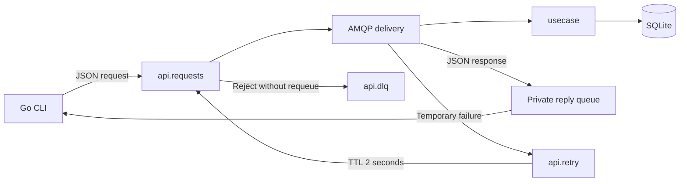

# Projects & Tasks — RabbitMQ API

Лабораторная работа №4 по дисциплине «Проектирование интеграционных решений».
Предметная область и операции перенесены из `API_1`: проекты и задачи,
CRUD, PATCH, фильтры и версии v1/v2. Запросы и ответы передаются через RabbitMQ.

## Запуск

Нужны Go 1.26+, Docker с Compose; на macOS подходит Colima.
Для `make lint` нужен golangci-lint v2, для `make fmt` — goimports.
Команды выполняются из `projects/University/Broker_4`.

При использовании Colima сначала запустите Docker и укажите его сокет в том
терминале, где выполняются команды `make broker-up`, `make broker-down` и `make queues`:

```sh
colima start
export DOCKER_HOST="unix://$HOME/.colima/default/docker.sock"
```

```sh
make setup
make broker-up
make build
make run
```

`make setup` один раз создаёт `config.local.json` с отдельными случайными ключом
API и паролем брокера. Файл имеет права 0600 и исключён из Git. Повторный запуск
сохраняет существующую конфигурацию. Образец структуры — `config.example.json`.
Настройки клиента, сервера и запуска Compose берутся из одного локального файла.

RabbitMQ работает в контейнере `rabbitmq:4-management`. AMQP доступен на
`127.0.0.1:5672`, панель управления — <http://127.0.0.1:15672>.
Пользователь и пароль панели соответствуют учётным данным в `rabbitmq_url`.
Ключ `api_key` используется только приложением и отличается от пароля брокера.
Порты опубликованы на localhost, данные RabbitMQ сохраняются в Docker volume.

Сервер и консольный клиент работают на компьютере. SQLite хранится в
`data/broker.db`; миграции применяются при запуске. `Ctrl+C` корректно завершает
сервер; неподтверждённое сообщение возвращается в очередь.

| Команда | Назначение |
|---|---|
| `make build` | Собрать `bin/server` и `bin/client` |
| `make run` | Запустить сервер |
| `make queues` | Показать очереди и число готовых/неподтверждённых сообщений |
| `make broker-down` | Остановить контейнер, сохранив volume |
| `make lint` | Проверить Go-код |
| `make fmt` | Форматировать код через goimports |
| `make reset-db` | Очистить проекты, задачи и результаты запросов; сбросить ID |
| `make reset-all` | Очистить SQLite и все сообщения в очередях лабораторной |

Перед `make reset-db` остановите сервер и убедитесь, что `api.requests` и
`api.retry` пусты. Эта команда удаляет данные приложения, но не сообщения брокера.
После очистки старые UUID снова можно использовать как новые запросы.

Для полного сброса остановите сервер через `Ctrl+C` и завершите запущенные
клиенты. RabbitMQ должен оставаться запущенным. Затем выполните:

```sh
make reset-all
make run
```

`reset-all` пересоздаёт пустые `api.requests`, `api.retry`, `api.dlq`, затем
очищает проекты, задачи, историю идемпотентности и счётчики ID в SQLite.
Очередь retry очищается вместе с остальными, поэтому отложенные команды
не попадут в новую демонстрацию. Временные reply-очереди удаляются при завершении
клиентов. Пользователи, пароли, Docker volume и локальная конфигурация сохраняются.
При активном потребителе в любой из трёх очередей сброс отклоняется до удаления
сообщений и данных. Во время сброса не запускайте сервер и не отправляйте запросы.
Используются обычные `CONFIG_PATH`, `RABBITMQ_URL` и `DB_PATH`; подключение идёт
напрямую по AMQP, поэтому для этой команды `DOCKER_HOST` не нужен.

Сброс RabbitMQ и SQLite не является общей транзакцией: если одна из операций
завершилась ошибкой, устраните её причину и повторите `make reset-all`.

| Переменная окружения | Назначение |
|---|---|
| `CONFIG_PATH` | Другой файл конфигурации; по умолчанию `config.local.json` |
| `RABBITMQ_URL` | Переопределить адрес и учётные данные AMQP |
| `API_KEY` | Переопределить ключ приложения |
| `DB_PATH` | Переопределить путь SQLite |
| `RATE_LIMIT` | Запросов в минуту; по умолчанию 60 |
| `LOG_LEVEL` | Уровень JSON-логов zap; по умолчанию info |

Существующий RabbitMQ volume сохраняет первоначальные учётные данные.
Изменение пароля в конфигурации не меняет пароль уже созданного пользователя брокера.
Для работы за пределами localhost нужны TLS (`amqps`) и отдельные права доступа.

## Архитектура и обмен



`cmd` содержит точки входа; `internal/delivery/amqp` — сообщения, доступ и
подтверждения; `internal/usecase` — бизнес-правила, диспетчер команд и
идемпотентность; `internal/repository/sqlite` — SQL; `pkg` — подключение,
логирование и миграции. Общий контракт находится в `internal/protocol`.
Расширения второй лабораторной (`include`, внутренняя статистика) сюда не перенесены.

| Очередь | Настройки и маршрут |
|---|---|
| `api.requests` | Durable; DLX — default exchange, routing key — `api.dlq` |
| `api.retry` | Durable; TTL 2000 мс; DLX — default exchange, routing key — `api.requests` |
| `api.dlq` | Durable; сообщения остаются для разбора |
| `amq.gen-…` | Отдельная exclusive/auto-delete очередь каждого клиента |

Публикация выполняется в default exchange: routing key равен имени очереди.
Клиент задаёт AMQP `message_id` и `correlation_id`, равные `id` JSON-запроса,
`reply_to` с именем своей очереди, `content_type=application/json` и persistent
delivery mode. Сервер использует prefetch=1 и ручной Ack. Публикации подтверждаются
брокером; `mandatory` позволяет обнаружить исчезнувшую очередь ответа.

Запрос:

```json
{
  "id": "11111111-1111-4111-8111-111111111111",
  "version": "v1",
  "action": "create_project",
  "data": {"name": "Лабораторная 4"},
  "auth": "<API-ключ из локальной конфигурации>"
}
```

Ответ:

```json
{
  "correlation_id": "11111111-1111-4111-8111-111111111111",
  "status": "ok",
  "data": {"id": 1, "name": "Лабораторная 4"},
  "error": null
}
```

При ошибке `status` равен `error`, `data` — null, `error` содержит `code` и
`message`. При успешном удалении `data` также null. `correlation_id` — UUID
запроса; числовой `data.id` — идентификатор проекта или задачи.

## Операции и версии

| Действия | Поля `data` |
|---|---|
| `create_project` | Обязательное `name` |
| `get_project`, `delete_project` | Обязательное `id` |
| `update_project`, `patch_project` | Обязательные `id`, `name` |
| `list_projects` | Для v2: необязательные `limit`, `offset` |
| `create_task` | Обязательные `project_id`, `title`; необязательные `completed`, `description` |
| `get_task`, `delete_task` | Обязательное `id` |
| `update_task` | `id`, `project_id`, `title`, `completed`; необязательное `description` |
| `patch_task` | `id` и хотя бы одно из `project_id`, `title`, `completed`, `description` |
| `list_tasks` | Фильтры `project_id`, `completed`; для v2 также `limit`, `offset` |

Все 12 действий доступны в обеих версиях. Название/заголовок после обрезки
пробелов содержит 1–200 символов, описание — не более 2000. ID положительные.
Проект задачи должен существовать. Проект с задачами удалить нельзя.
Частичное обновление сохраняет пропущенные поля; null в PATCH запрещён.
Полное обновление задачи требует `completed`; отсутствие описания очищает его.
При создании отсутствие/null у `completed` и `description` означает false и
пустую строку. Неизвестные поля и неверные типы запрещены; запрос — до 64 КиБ.

v1: `data` списка — массив. v2: `data` — объект
`{"items":[],"total":0,"limit":20,"offset":0}`. Размер страницы 1–100,
по умолчанию 20; offset неотрицателен, по умолчанию 0. `total` учитывает фильтры,
но не пагинацию. Сортировка по ID, пустой список — `[]`. В v1 параметры
пагинации не принимаются. Версии используют общие данные и бизнес-правила.

## Идемпотентность, ошибки и ограничения

Для изменяющих команд область UUID — аутентифицированный клиент. Отпечаток
включает версию, действие и нормализованные поля: порядок JSON, пробелы вокруг
названия и явно переданные значения по умолчанию не меняют смысл запроса.
Один UUID с другим действием, версией или данными даёт `idempotency_conflict`.

Изменение данных и сохранение результата выполняются в одной транзакции
SQLite (`BEGIN IMMEDIATE`). Только после commit сервер отправляет ответ,
ожидает publisher confirm и делает Ack исходного запроса. Если процесс
прервётся после commit, повторная доставка вернёт сохранённый ответ без
повторного изменения. Результаты сохраняются до явной очистки базы.
Чтение выполняется заново; ошибки бизнес-правил не занимают UUID.

Повтор возвращает **исходный ответ**, даже если объект затем изменён или удалён.
Для текущего состояния используйте `get_*` с новым UUID. Возможна повторная
доставка ответа после сбоя между его публикацией и Ack; это at-least-once
доставка с идемпотентной обработкой, а не гарантия exactly-once транспорта.

| Ситуация | Поведение |
|---|---|
| Ошибка доступа, входных данных или бизнес-правил | Ответ с ошибкой, Ack, без retry |
| Неизвестная версия/операция, повреждённый конверт | Ответ при доступной reply-очереди, затем DLQ |
| Внутренняя ошибка обработки, например блокировка SQLite | До 3 попыток с задержкой 2 секунды через `api.retry` |
| Попытки исчерпаны | `retry_exhausted`, затем DLQ |
| Клиент отключился и его очередь удалена | Результат остаётся в БД, запрос подтверждается; повтор с тем же UUID вернёт результат |
| Потеря соединения с RabbitMQ | Процесс сообщает об ошибке; после перезапуска обработка продолжается |

Повторная публикация подтверждается до Ack исходной доставки. Блокировка SQLite
ожидается до 1 секунды; обработка в БД и операции AMQP ограничены таймаутами.
Очереди — classic durable; для отказоустойчивого кластера и более сильных
гарантий DLX нужны quorum queues и соответствующие политики RabbitMQ.

API-ключ сравнивается в постоянное время, в таблице обработанных запросов
используется его SHA-256, а не открытый ключ. Логи не содержат тела запросов или
секретов. Сообщения в очередях, включая DLQ, содержат `auth`, поэтому доступ к
брокеру и панели управления требует отдельных учётных данных.

По умолчанию разрешено 60 аутентифицированных доставок в минуту, суммарно для
v1/v2. Повторы и попытки retry также учитываются. Ответ содержит AMQP-заголовок
`X-Limit-Remaining`, при исчерпании — `Retry-After` в секундах. Счётчик находится
в памяти одного сервера и сбрасывается при его перезапуске. Учебная конфигурация
рассчитана на один сервер; у нескольких процессов нет общего лимитера.

## Клиент

```sh
./bin/client -version v2 -action list_tasks -data '{"limit":1}'
```

Параметры: `-action` обязателен; `-version` по умолчанию v1; `-data` по умолчанию
`{}`; `-id` по умолчанию новый UUID; `-timeout` по умолчанию 30s.
Ответ JSON выводится в stdout, UUID и AMQP-заголовки — в stderr.
Ошибка даёт ненулевой код завершения. API-ключ читается из конфигурации.
Таймаут не отменяет уже отправленную команду: повторите её с прежним `-id`.

## Последовательная проверка

Первый проход — на пустой базе. Сервер запущен в первом терминале; команды ниже
выполняются во втором. UUID в примерах — идентификаторы операций, не секреты.
Для нового прохода сначала остановите сервер и клиентов, выполните `make reset-all`,
затем снова `make run`. Все ID начнутся с 1, очереди и история запросов будут пустыми.
Ожидаемые ошибки завершают отдельную команду с кодом 1; это нормальный результат
этих проверок. Не запускайте весь раздел как скрипт с `set -e`.

### 1. Создание

```sh
project_request=11111111-1111-4111-8111-111111111111
task_request=22222222-2222-4222-8222-222222222222
./bin/client -action create_project -id "$project_request" \
  -data '{"name":"Лабораторная 4"}'
./bin/client -action create_task -id "$task_request" \
  -data '{"project_id":1,"title":"Подготовить отчёт"}'
./bin/client -version v2 -action create_task \
  -data '{"project_id":1,"title":"Проверить RabbitMQ","description":"Проверить очереди"}'
```

Ожидаются проект ID=1 и задачи ID=1,2. У первой задачи completed=false,
description=""; у второй заполнено описание.

### 2. Чтение, версии и фильтры

```sh
./bin/client -action get_project -data '{"id":1}'
./bin/client -version v2 -action get_task -data '{"id":1}'
./bin/client -action list_projects
./bin/client -action list_tasks
./bin/client -version v2 -action list_projects -data '{"limit":1}'
./bin/client -version v2 -action list_tasks -data '{"limit":1,"offset":0}'
./bin/client -version v2 -action list_tasks -data '{"limit":1,"offset":1}'
./bin/client -version v2 -action list_tasks -data '{"limit":1,"offset":99}'
./bin/client -action list_tasks -data '{"project_id":1,"completed":false}'
```

v1 возвращает массив, v2 — страницу. У страниц задач total=2; offset=99
возвращает пустой items с сохранённым total. Фильтр возвращает обе задачи.

### 3. Обновление

```sh
./bin/client -action patch_task -data '{"id":1,"completed":true}'
./bin/client -version v2 -action update_task \
  -data '{"id":2,"project_id":1,"title":"Проверить retry","completed":true}'
./bin/client -action update_project -data '{"id":1,"name":"Демонстрация"}'
./bin/client -version v2 -action patch_project -data '{"id":1,"name":"Лабораторная 4"}'
./bin/client -version v2 -action list_tasks -data '{"project_id":1,"completed":true}'
```

PATCH первой задачи сохраняет название; update_task второй очищает описание.
В конце обе задачи выполнены.

### 4. Идемпотентность и перезапуск

```sh
./bin/client -action create_project -id "$project_request" \
  -data '{"name":"  Лабораторная 4  "}'
./bin/client -action create_task -id "$task_request" \
  -data '{"title":"Подготовить отчёт","project_id":1,"completed":false,"description":""}'
./bin/client -version v2 -action list_tasks
./bin/client -action create_project -id "$project_request" -data '{"name":"Другой проект"}'
```

Первые две команды возвращают исходные ID; у повторённой create_task completed=false
из первоначального ответа, хотя текущее состояние задачи — true. total остаётся 2.
Последняя команда возвращает idempotency_conflict. Остановите сервер Ctrl+C,
выполните `make run` и повторите первые две команды: результат сохранится.

### 5. Ошибки и DLQ

```sh
API_KEY=intentionally-invalid ./bin/client -action list_projects
./bin/client -action create_project -data '{"name":""}'
./bin/client -action delete_project -data '{"id":1}'
./bin/client -version v2 -action list_tasks -data '{"limit":0}'
./bin/client -version v9 -action list_projects
./bin/client -action unknown_action
make queues
```

Ожидаемые коды: unauthorized, invalid_request, project_not_empty, invalid_request,
unsupported_version, unsupported_action. Последние две команды увеличивают DLQ
на два сообщения. Предыдущие бизнес-ошибки в DLQ не попадают.

### 6. Retry при настоящей блокировке БД

Для сценариев нужен Python 3 со стандартным модулем sqlite3.
Вспомогательный скрипт берёт write lock и запускает клиент только после его
получения; данные сам не меняет. Используйте демонстрационную базу.

```sh
python3 scripts/hold_db_lock.py --seconds 3.5 -- \
  ./bin/client -action create_project -data '{"name":"Retry success"}'
python3 scripts/hold_db_lock.py --seconds 12 -- \
  ./bin/client -action create_project -data '{"name":"Retry exhausted"}'
make queues
./bin/client -action list_projects
```

Первая команда завершается успешно после retry. Вторая получает retry_exhausted
после третьей попытки и увеличивает DLQ ещё на одно сообщение. Проект
«Retry exhausted» отсутствует. Попытки видны в JSON-логах сервера.
При другом DB_PATH передайте тот же путь скрипту через `--db`.

### 7. Лимит

Остановите сервер и запустите его с уменьшенным лимитом:

```sh
RATE_LIMIT=3 make run
```

Во втором терминале:

```sh
./bin/client -action list_projects
./bin/client -action list_projects
./bin/client -version v2 -action list_projects
./bin/client -action list_projects
```

Четвёртый ответ: rate_limit_exceeded, X-Limit-Remaining=0 и Retry-After.
После проверки перезапустите сервер обычной командой `make run`.

### 8. Удаление

```sh
delete_request=33333333-3333-4333-8333-333333333333
./bin/client -action delete_task -id "$delete_request" -data '{"id":1}'
./bin/client -action delete_task -id "$delete_request" -data '{"id":1}'
./bin/client -version v2 -action delete_task -data '{"id":2}'
./bin/client -action delete_project -data '{"id":1}'
./bin/client -action get_project -data '{"id":1}'
```

Повтор удаления с тем же UUID тоже успешен. Последний GET-подобный запрос
возвращает project_not_found. Дополнительный проект из проверки retry остаётся.

## Сравнение с REST

REST даёт прямой запрос/ответ и привычные HTTP-коды, но требует доступности
сервера в момент обращения. RabbitMQ сохраняет запросы до обработки, позволяет
разнести клиент и сервер по времени и управлять нагрузкой через очередь и prefetch.
Вместо HTTP-кодов используются status/error, вместо заголовков — AMQP properties
и headers. Требуются корреляция ответов, подтверждения, retry, DLQ и защита от
повторной доставки. SQLite-транзакция обеспечивает идемпотентное изменение данных;
брокер отвечает за передачу сообщений.
